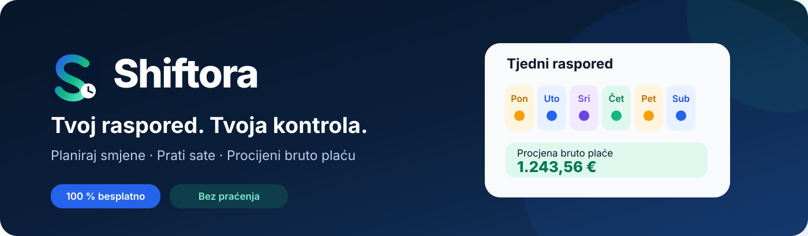

  
   
  <strong>Moje smjene. Moji sati.</strong>
    
  
  
  
  

 

## Sve smjene. Svi sati. Jedno mjesto.

**Shiftora** je osobni kalendar radnih smjena za Android. Planiraj svoj radni tjedan, prati stvarno odrađene sate i pregledaj procjenu bruto zarade — u jednostavnoj aplikaciji potpuno na hrvatskom jeziku.

**Bez reklama · Bez pretplate · Bez registracije · Bez praćenja · Radi izvan mreže.**

## Upoznaj Shiftoru

<table><tr>
<td align="center" width="33%"> <strong>Početna</strong> Smjene koje dolaze, sati i brze akcije</td>
<td align="center" width="33%"> <strong>Kalendar</strong> Mjesečni i tjedni pregled smjena</td>
<td align="center" width="33%"> <strong>Statistika</strong> Radni sati, dodatci i izvještaji</td>
</tr><tr>
<td align="center"> <strong>Plaća</strong> Transparentna bruto procjena</td>
<td align="center"> <strong>Više</strong> Izvoz, postavke i sigurnosne kopije</td>
<td align="center"> <strong>Dobrodošli</strong> Prvi koraci, bez otvaranja računa</td>
</tr></table>
Stvarne snimke Android aplikacije na emulatoru, s demonstracijskim smjenama. Prikaz može odstupati ovisno o uređaju.

## Pametne mogućnosti

<table>
<tr><td width="64"></td><td><strong>Kalendar koji razumije smjene</strong> Jutarnja, popodnevna, noćna, slobodno i prilagođena smjena. Vlastiti ciklusi i automatsko ponavljanje rasporeda.</td></tr>
<tr><td></td><td><strong>Precizna evidencija sati</strong> Planirani i odrađeni sati, plaćene i neplaćene pauze, noćni i prekovremeni rad te prelazak preko ponoći.</td></tr>
<tr><td></td><td><strong>Statistika koja ima smisla</strong> Pregled po tjednima, mjesecima i godinama, uključujući nedjelje i hrvatske blagdane.</td></tr>
<tr><td></td><td><strong>Procjena bruto plaće</strong> Unesi vlastitu bruto satnicu i postotke dodataka. Prikaži osnovicu i dodatke zasebno.</td></tr>
<tr><td></td><td><strong>Podatci ostaju tvoji</strong> Lokalna pohrana, CSV izvoz, sigurnosna kopija i vraćanje podataka uz tvoju potvrdu.</td></tr>
</table>

## Preuzmi Shiftoru

[**Pogledaj izdanja i preuzmi APK →**](https://github.com/bren-wp/Shiftora/releases)

Odaberi najnovije izdanje i preuzmi **APK** za Android. Uz izdanja je dostupan i **AAB** za distribuciju. Za objavu na Google Playu potreban je valjano potpisan AAB; nepotpisane pakete nije moguće izravno objaviti.

## Privatnost na prvom mjestu

Shiftora ne zahtijeva korisnički račun, nema analitiku, praćenje ni dozvolu za internet. Rasporedi i postavke čuvaju se lokalno na uređaju. Izvoz i sigurnosna kopija događaju se samo kada ih sam pokreneš.

## Česta pitanja

**Radi li aplikacija bez interneta?** Da. Kalendar, evidencija i obračun rade izvan mreže.

**Mogu li prilagoditi svoje smjene?** Da. Vrijeme, pauzu, vrstu i ponavljanje smjena podešavaš sam.

**Je li procjena plaće službeni obračun?** Nije. Procjena prikazuje bruto osnovicu i dodatke prema unesenim postavkama; stvarni obračun ovisi o ugovoru, primjenjivim pravilima i poreznim okolnostima.

**Mogu li prenijeti raspored na drugi uređaj?** Da. Spremi sigurnosnu kopiju i vrati je na novom uređaju.

---

  <strong>Shiftora</strong> · Android · Hrvatski jezik · © 2026 <a href="https://brendigo.com">Brendigo</a> 
  Izvorni kod je dostupan pod <a href="LICENSE">MIT licencom</a>.

